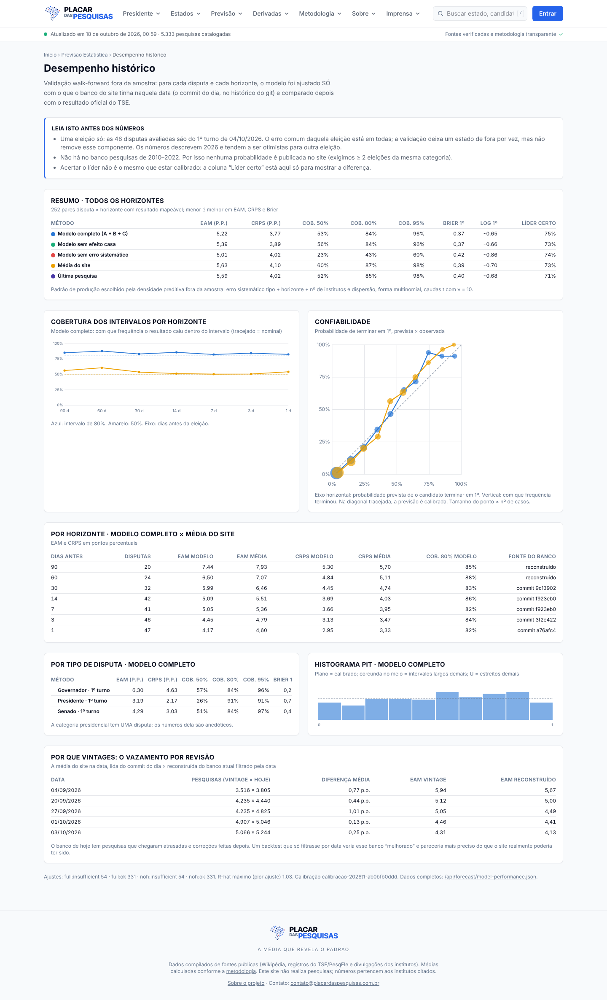

# Validação da Previsão Estatística

Resultados **medidos** da validação histórica do modelo descrito em
[`FORECASTING_METHODOLOGY.md`](FORECASTING_METHODOLOGY.md). Todo número aqui sai
de `data/forecast/backtests/backtest-2026-10-04-t1-placar-previsao-v1.json` e
`data/forecast/calibration/calibracao-2026t1-ab0bfb0ddd.json`, gerados por
`python3 forecast/run.py backtest-fit` + `backtest-evaluate` em 18/10/2026
(config `placar-previsao-v1`, modelo 1.0.0). A mesma informação está em
`/previsao/desempenho` e `/api/forecast/model-performance.json`.

---

## 0. Leia antes dos números

1. **Uma eleição só.** Todas as disputas avaliadas são do 1º turno de
   04/10/2026. O erro comum daquela eleição está em todas; a validação cruzada
   deixa um estado de fora por vez, mas não remove esse componente. Os números
   abaixo descrevem 2026 e tendem a ser **otimistas** para outra eleição.
2. **Não há 2010, 2014, 2018 nem 2022.** O repositório só tem pesquisas de
   2026, e o ambiente de desenvolvimento não tinha acesso de rede à Wikipédia
   nem ao TSE para coletá-las. Nada foi reconstruído de memória ou inventado.
   O código aceita essas eleições sem mudança quando entrarem no store com o
   resultado oficial (§8).
3. **Nenhum 2º turno com resultado.** A previsão publicada hoje (2º turno de
   25/10) usa um erro sistemático **emprestado** do 1º turno, sem validação
   própria. Por isso a projeção é marcada experimental e **nenhuma
   probabilidade é publicada**.
4. A amostra é pequena para calibrar probabilidades com segurança: 252 pares
   disputa × horizonte, de **48 disputas**, fortemente correlacionados entre
   horizontes da mesma disputa e entre disputas da mesma eleição.

## 1. Desenho

| Item | Valor |
|---|---|
| Eleição | 1º turno, 04/10/2026 (resultado TSE em `data/resultados-oficiais.json`) |
| Horizontes | 90, 60, 30, 14, 7, 3, 1 dia antes |
| Disputas com resultado | presidente (1), governador (27), Senado (27) |
| Ajustes do Modelo A | 770 tentados (2 variantes × 55 disputas × 7 horizontes); **662 ok**, 108 com dados insuficientes (< 4 pesquisas elegíveis), **0 erros** |
| Pares avaliados | **252** (de 331 pares com ajuste): 79 descartados porque um candidato acompanhado não tem resultado mapeável (desistência, candidatura barrada, ou identidade ambígua na urna — §6.2) |
| Banco por data | vintage do git para 30, 14, 7, 3 e 1 dia; reconstruído (banco atual + regra de disponibilidade) para 90 e 60 dias, anteriores ao primeiro commit (12/08) |

Os vintages usados:

| Horizonte | Data | Commit | Commit em (UTC) |
|---|---|---|---|
| 90 | 06/07 | — (reconstruído) | — |
| 60 | 05/08 | — (reconstruído) | — |
| 30 | 04/09 | `9c13902` | 01/09 16:53 |
| 14 | 20/09 | `f923eb0` | 18/09 18:44 |
| 7 | 27/09 | `f923eb0` | 18/09 18:44 |
| 3 | 01/10 | `3f2e422` | 02/10 02:32 |
| 1 | 03/10 | `a76afc4` | 04/10 02:48 |

14 e 7 dias usam o **mesmo** commit: o cron ficou parado de 18 a 29/09 (issue
#118). É o que o site realmente tinha — a validação mede o Placar como ele
existiu, não um Placar ideal.

## 2. Comparação de modelos (todos os horizontes, 252 pares)

Todos os métodos usam o mesmo mecanismo de calibração do erro, ajustado sem o
estado avaliado. EAM e CRPS em pontos percentuais por candidato acompanhado.

| Método | EAM | CRPS | Cob. 50% | Cob. 80% | Cob. 95% | Brier 1º | Log 1º | Brier top-2 | Brier "decide no 1º" | Líder certo |
|---|---|---|---|---|---|---|---|---|---|---|
| **Modelo completo** | **5,22** | **3,77** | 53% | 84% | 96% | **0,372** | **−0,653** | 0,136 | 0,177 | 75% |
| Modelo sem efeito casa | 5,39 | 3,89 | 56% | 84% | 96% | 0,373 | −0,657 | 0,136 | 0,178 | 73% |
| Modelo sem erro sistemático | 5,01 | 4,02 | **23%** | **43%** | **60%** | 0,425 | −0,862 | 0,176 | 0,227 | 74% |
| Média do site (+ erro calibrado) | 5,63 | 4,10 | 60% | 87% | 98% | 0,390 | −0,696 | 0,135 | 0,184 | 73% |
| Última pesquisa (+ erro calibrado) | 5,59 | 4,02 | 52% | 85% | 98% | 0,396 | −0,680 | **0,125** | **0,157** | 71% |

Densidade preditiva fora da amostra (média por par, nats; maior é melhor):
modelo −3,73 · sem efeito casa −3,94 · última pesquisa −4,28 · média do site
−4,39 · sem erro sistemático −28,39.

Leitura:

* O modelo completo é o melhor em EAM, CRPS, Brier e log-escore de quem
  termina em 1º, e na densidade preditiva. As margens sobre as bases são
  **modestas** (CRPS 3,77 × 4,02–4,10; Brier 0,372 × 0,390–0,396) e vêm de
  uma eleição só.
* A **última pesquisa** tem Brier melhor em "entre os dois primeiros" e em
  "decide no 1º turno". O modelo não é melhor em tudo, e isto fica registrado.
* **Sem erro sistemático**, os intervalos cobrem 43% em vez de 80%: tratar a
  margem de erro amostral como a incerteza total é o erro mais caro que um
  agregador pode cometer, e a validação mostra o tamanho dele. A mediana desse
  método tem EAM menor (5,01) porque o ruído sistemático, ao ser somado na
  escala log e desfeito, puxa um pouco as medianas das frações — efeito pequeno
  depois da forma multinomial (§4), mas visível.
* O efeito casa melhora EAM (5,39 → 5,22) e a densidade (−3,94 → −3,73), e
  quase nada o Brier.
* **Líder certo** está na tabela só para mostrar que não mede calibração: 75%
  × 73% × 74% para métodos com Brier de 0,372 a 0,425.

## 3. Calibração

### 3.1 Cobertura por horizonte (modelo completo)

| Dias antes | Disputas | EAM modelo | EAM média | CRPS modelo | CRPS média | Cob. 80% | Brier 1º |
|---|---|---|---|---|---|---|---|
| 90 | 20 | 7,44 | 7,93 | 5,30 | 5,70 | 85% | 0,434 |
| 60 | 24 | 6,50 | 7,07 | 4,84 | 5,11 | 88% | 0,431 |
| 30 | 32 | 5,99 | 6,46 | 4,45 | 4,74 | 83% | 0,386 |
| 14 | 42 | 5,09 | 5,51 | 3,69 | 4,03 | 86% | 0,383 |
| 7 | 41 | 5,05 | 5,36 | 3,66 | 3,95 | 82% | 0,373 |
| 3 | 46 | 4,45 | 4,79 | 3,13 | 3,47 | 84% | 0,345 |
| 1 | 47 | 4,17 | 4,60 | 2,95 | 3,33 | 82% | 0,319 |

A cobertura de 80% fica entre 82% e 88% em todos os horizontes: levemente
**subconfiante** (intervalos um pouco largos), estável no tempo. Não foi
"corrigida" à mão.

### 3.2 Por tipo de disputa (modelo completo)

| Tipo | Pares | Disputas | EAM | CRPS | Cob. 50/80/95% | Brier 1º |
|---|---|---|---|---|---|---|
| Governador | 147 | 25 | 6,30 | 4,63 | 57 / 84 / 96% | 0,288 |
| Senado | 98 | 22 | 4,29 | 3,03 | 51 / 84 / 97% | 0,468 |
| Presidente | 7 | 1 | 3,19 | 2,17 | 26 / 91 / 91% | 0,768 |

O presidencial é UMA disputa vista em sete datas: seus números são anedóticos.
O Brier alto do presidencial (0,768) é a disputa apertada Lula × Flávio com o
modelo dando ~50/50 — em que o Brier de qualquer previsão honesta é alto.

### 3.3 Confiabilidade (probabilidade de terminar em 1º)

| Faixa prevista | n | Média prevista | Frequência observada |
|---|---|---|---|
| 0–10% | 417 | 3% | 1% |
| 10–20% | 135 | 14% | 11% |
| 20–30% | 82 | 25% | 21% |
| 30–40% | 55 | 35% | 35% |
| 40–50% | 58 | 45% | 47% |
| 50–60% | 60 | 56% | 65% |
| 60–70% | 53 | 65% | 72% |
| 70–80% | 33 | 74% | 94% |
| 80–90% | 34 | 85% | 91% |
| 90–100% | 34 | 95% | 91% |

Abaixo de 50% as probabilidades estão próximas da diagonal; entre 50% e 90%
o favorito vence mais do que o modelo diz (subconfiança, coerente com a
cobertura de 84%). Com 33–60 casos por faixa, de uma eleição, a incerteza de
cada ponto é de ±7–9 p.p.

PIT (10 faixas, modelo completo): 77, 64, 94, 94, 90, 124, 101, 116, 124, 77 —
sem forma de U (intervalos não são estreitos demais); ligeiro excesso no meio
e à direita.

## 4. Seleção do erro sistemático (Modelo C)

Combinações forma × variante × ν, por densidade preditiva média deixando um
estado de fora (as 6 melhores de 25):

| Forma | Variante | ν | Densidade | Diferença p/ a melhor | EP da diferença |
|---|---|---|---|---|---|
| multinomial | tipo + horizonte + covariáveis | 10 | **−3,728** | — | — |
| multinomial | tipo + horizonte + covariáveis | 5 | −3,750 | 0,022 | 0,008 |
| multinomial | tipo + horizonte + covariáveis | ∞ | −3,759 | 0,031 | 0,021 |
| multinomial | tipo + horizonte | 10 | −3,768 | 0,040 | 0,024 |
| multinomial | tipo + horizonte | 5 | −3,779 | 0,051 | 0,020 |
| multinomial | tipo + horizonte + covariáveis | 3 | −3,798 | 0,071 | 0,015 |

Melhor isotrópica: −4,12 (tabela completa no arquivo de calibração). Regra de escolha: a combinação mais **simples** a menos de um
erro-padrão (pareado) da melhor. Nenhuma mais simples ficou dentro de 1 EP, e
a escolhida é **multinomial, tipo + horizonte + covariáveis, ν = 10**.

Parâmetros (escala log de s):

| | Valor |
|---|---|
| α_0 (média agrupada) | −2,080 |
| α presidente 1º t. / governador 1º t. / Senado 1º t. | −1,823 / −1,968 / −2,220 |
| β (horizonte, por log(1 + h/7)) | 0,196 |
| γ (nº de institutos; dispersão), padronizados | −0,062; 0,166 |

Escala s resultante (forma multinomial; o erro na fração de um candidato com
p ≈ 50% é ≈ s/2 em desvio de escala t):

| Categoria | 1 dia | 7 dias | 30 dias | 90 dias |
|---|---|---|---|---|
| Presidente 1º t. | 0,166 | 0,185 | 0,224 | 0,271 |
| Governador 1º t. | 0,143 | 0,160 | 0,194 | 0,234 |
| Senado 1º t. | 0,111 | 0,124 | 0,151 | 0,182 |
| 2º turno (emprestado, α_0) | 0,128 | 0,143 | 0,173 | 0,209 |

## 5. Vazamento por revisão: por que vintages

Para as datas com vintage, a média do site foi recalculada sobre o banco ATUAL
filtrado pela data (o que um backtest só com filtro por data faria):

| Data | Pesquisas (vintage × hoje até a data) | Diferença média na média do site | EAM vintage | EAM reconstruído |
|---|---|---|---|---|
| 04/09 | 3.516 × 3.805 | 0,77 p.p. | 5,94 | 5,67 |
| 20/09 | 4.235 × 4.440 | 0,44 p.p. | 5,12 | 5,00 |
| 27/09 | 4.235 × 4.825 | 1,01 p.p. | 5,05 | 4,49 |
| 01/10 | 4.907 × 5.046 | 0,13 p.p. | 4,46 | 4,41 |
| 03/10 | 5.066 × 5.244 | 0,25 p.p. | 4,31 | 4,13 |

O banco de hoje tem até 590 pesquisas a mais "disponíveis" numa data passada
(chegaram atrasadas, ou foram corrigidas e reprocessadas). Em **todas** as
datas o reconstruído parece mais preciso que o vintage — até 0,56 p.p. de EAM
em 27/09, no meio da parada do cron. Um backtest só com filtro por data teria
superestimado a precisão do site.

## 6. Falhas identificadas e corrigidas durante a validação

Registradas porque cada uma mudou o resultado:

1. **Gibbs centrado não misturava** (ESS de σ_rw 34–100 em 4 × 1.000): trocado
   por MCMC marginal com μ e h integrados e proposta refletida (METHODOLOGY §4.2).
2. **Erro sistemático isotrópico** deixava o modelo subconfiante (cobertura de
   80% em 91%, PIT em corcunda, densidade −4,53) e puxava medianas para frações
   iguais. A forma multinomial foi preferida pelos dados (−4,17 na mesma
   comparação, antes do item 3).
3. **Identidade ambígua na urna (Senado/SC)**: o TSE lista "Carol de Toni"
   (33,46%) e OUTRA "Carol" (0,15%); o candidato do store tem as duas grafias
   como apelido. Na primeira avaliação a fração de 0,15% sobrescreveu a de
   33,46% e gerou um "erro de pesquisa" fantasma de 25 p.p. Com ele, a seleção
   escolhia caudas ν = 3; sem ele, ν = 10. O exportador agora recusa nomes da
   urna que resolvem para o mesmo id (`ambiguous_official`), e SC/Senado sai da
   avaliação. **O mesmo defeito existe no ranking "Quem chegou mais perto das
   urnas" do site (`src/lib/acerto.ts`), que não foi alterado** — registrado em
   `ESTADO.md` para decisão do criador.
4. **Seleção sem parcimônia** escolhia covariáveis por 0,008 nat — um empate —
   e extrapolava o coeficiente para o 2º turno presidencial (22 institutos, 2,6
   dp acima do visto). Adotada a regra de um erro-padrão. Na versão final as
   covariáveis vencem por mais de 1 EP e ficam.
5. **Regra de um erro-padrão com densidade −∞**: para as bases pontuais, a
   variante sem erro sistemático tem densidade −∞, EP infinito, e "empatava";
   as bases saíam com intervalos de largura zero. Corrigido e coberto por teste.
6. **JSON com `Infinity`**: o arquivo de backtest saiu com `-Infinity` e o site
   o recusou inteiro ("Nenhum backtest publicado"). Gravação agora com
   `allow_nan=False` e valores não finitos como `null`; teste de regressão.

## 7. Diagnósticos de convergência

* Backtest (4 × 500 + 1.000): R-hat máximo por ajuste com mediana 1,011 e pior
  1,035; **100% ≤ 1,05**, 40% ≤ 1,01. ESS mínimo com mediana 450 e pior 194.
  O backtest roda cadeias mais curtas que a produção; o portão de publicação
  (R-hat ≤ 1,01, ESS ≥ 400) não é aplicado a ele, e isto fica dito.
* Produção (4 × 1.000 + 3.000), rodada de 18/10/2026 — todas passaram:

| Disputa | Pesquisas | Institutos | Última (campo) | R-hat máx. | ESS mín. | 1º nome | Média do site | Estimativa atual (80%) | Projeção 25/10 (80%) | Parcela sistemática |
|---|---|---|---|---|---|---|---|---|---|---|
| Presidente | 137 | 22 | 16/10 | 1,004 | 1.047 | Flávio Bolsonaro | 51,1 | 50,6 (49,9–51,3) | 51 (44–57) | 97% |
| Gov. AC | 16 | 7 | 12/10 | 1,010 | 987 | Mailza Assis | 50,3 | 54,1 (49,0–59,9) | 54 (41–68) | 81% |
| Gov. AM | 19 | 10 | 12/10 | 1,003 | 1.219 | Omar Aziz | 55,5 | 56,1 (54,1–58,8) | 56 (47–65) | 91% |
| Gov. DF | 21 | 9 | 13/10 | 1,006 | 1.014 | Celina Leão | 62,4 | 61,3 (59,0–63,2) | 61 (53–69) | 90% |
| Gov. ES | 15 | 5 | 13/10 | 1,006 | 1.312 | Lorenzo Pazolini | 50,6 | 52,2 (48,4–56,8) | 52 (42–62) | 80% |
| Gov. RN | 14 | 8 | 12/10 | 1,003 | 803 | Allyson | 58,8 | 59,3 (55,4–61,8) | 59 (46–71) | 92% |
| Gov. TO | 15 | 5 | 13/10 | 1,006 | 947 | Professora Dorinha | 50,1 | 50,4 (48,1–52,2) | 50 (41–60) | 93% |

Projeções experimentais (erro emprestado). Probabilidade de vitória publicada
como **experimental** por decisão editorial de 18/10 (METHODOLOGY §8): nenhuma
delas tem validação de 2º turno; a calibração de probabilidades medida aqui é
só a do 1º turno (§3.3). Chance do líder na rodada de 18/10: presidente
Flávio Bolsonaro 55%; governadores AC Mailza Assis 66%, AM Omar Aziz 81%, DF
Celina Leão 95%, ES Lorenzo Pazolini 61%, RN Allyson 82%, TO Professora
Dorinha 52%. A
projeção é dominada (80–97%) pelo erro sistemático emprestado, calibrado
sobretudo em governadores e Senado de 1º turno — é provável que seja larga
demais para o 2º turno presidencial, mas não há dado para afirmar isso.

No AC a estimativa atual (54%) se afasta da média do site (50,3%): a média de
10 pesquisas ainda carrega as de agosto, e as duas pesquisas pós-1º turno
(12/10) deram 66,9% e 60,5%. O modelo segue a tendência, com intervalo largo.

## 8. O que muda quando houver mais eleições

* Pesquisas de 2010–2022 (ou de 2030) no store, com o resultado oficial em
  `data/resultados-oficiais.json` e o histórico de vintages (ou a regra de
  disponibilidade), entram em `backtest-fit` sem mudança de código: o plano lê
  a eleição e os horizontes da configuração.
* O 2º turno de 2026 entra assim que o TSE publicar o resultado de 25/10: o
  backtest de 2º turno usa os snapshots e os vintages já gravados.
* O portão de probabilidade abre por categoria quando ela tiver ≥ 2 eleições
  e ≥ 20 disputas com resultado, e cobertura de 80% a ±10 p.p.

## 9. Incertezas que permanecem

* Correlação do erro entre disputas da mesma eleição: medida só
  indiretamente; a validação por estado não a remove.
* Covariáveis estimadas em 1º turno aplicadas ao 2º turno (com 22 institutos no
  presidencial, fora da faixa vista): efeito pequeno (γ = −0,06), mas é
  extrapolação.
* 79 pares descartados por candidato sem resultado mapeável: se as desistências
  se concentram em disputas com mais erro, a avaliação é otimista.
* Os horizontes de 90 e 60 dias são reconstruídos, não vintages.
* Cadeias do backtest mais curtas que as de produção (§7).

## 10. Reprodutibilidade verificada

* `python3 forecast/run.py reproduce data/forecast/snapshots/governador-to-2026-t2/…`
  → "reproduzido bit a bit".
* Segunda rodada com a mesma entrada: "sem mudança material" nas 7 disputas,
  `index.json` idêntico (md5), 3 s.
* Testes: 40 em Python (unitários e estatísticos), 10 em Node (exportador,
  conferência, paridade do hash Python ↔ TypeScript em 3.020 números), 66
  verificações ponta a ponta no site construído (sem estouro horizontal em
  320/375/1440 px, claro e escuro).
